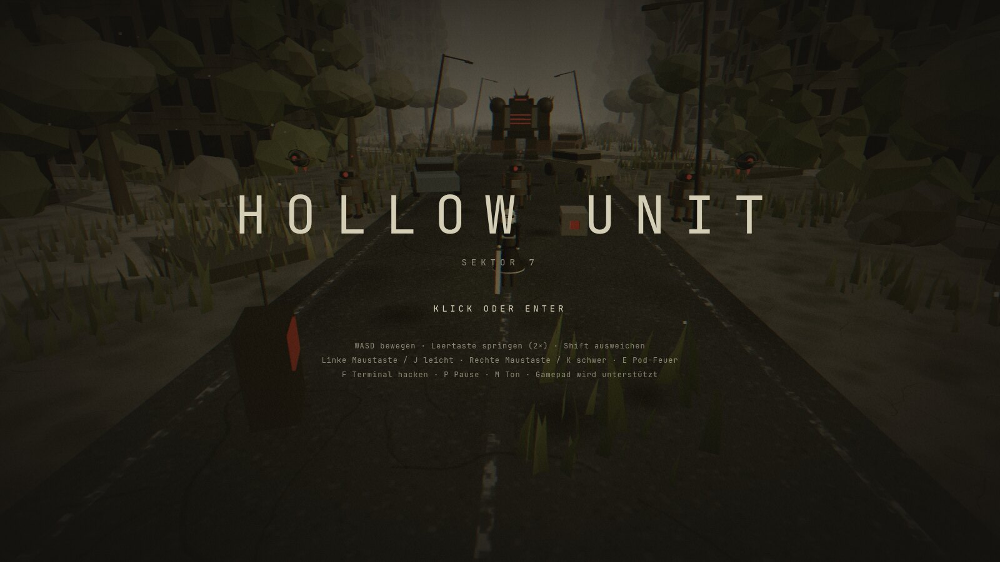
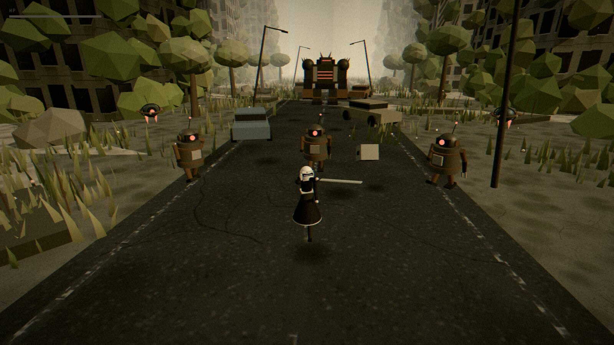
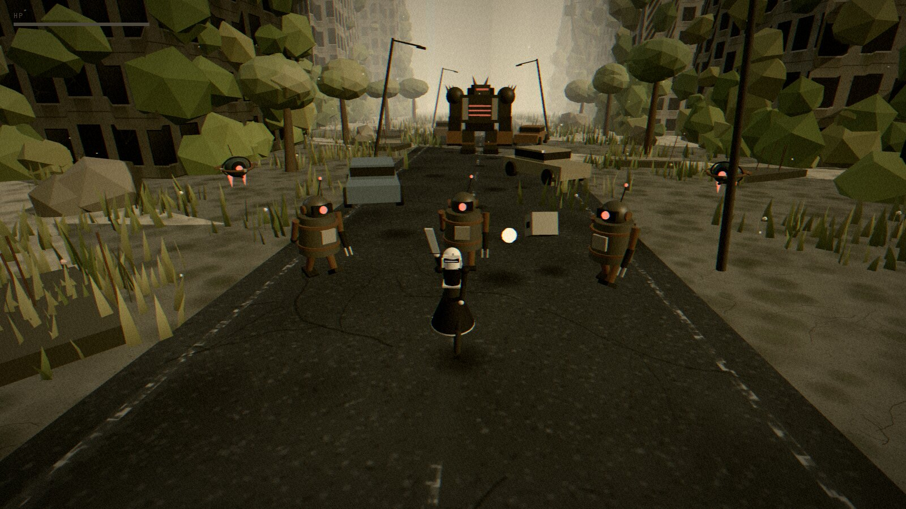
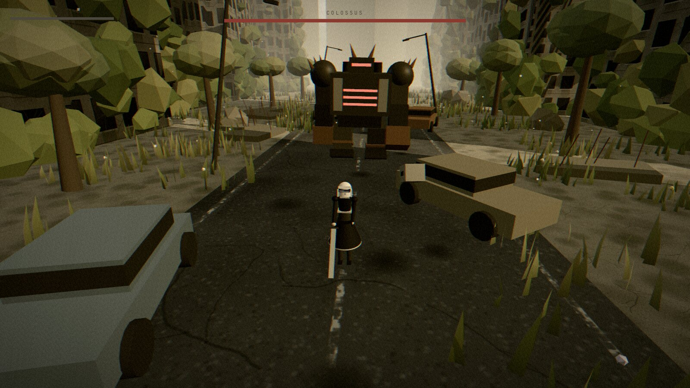
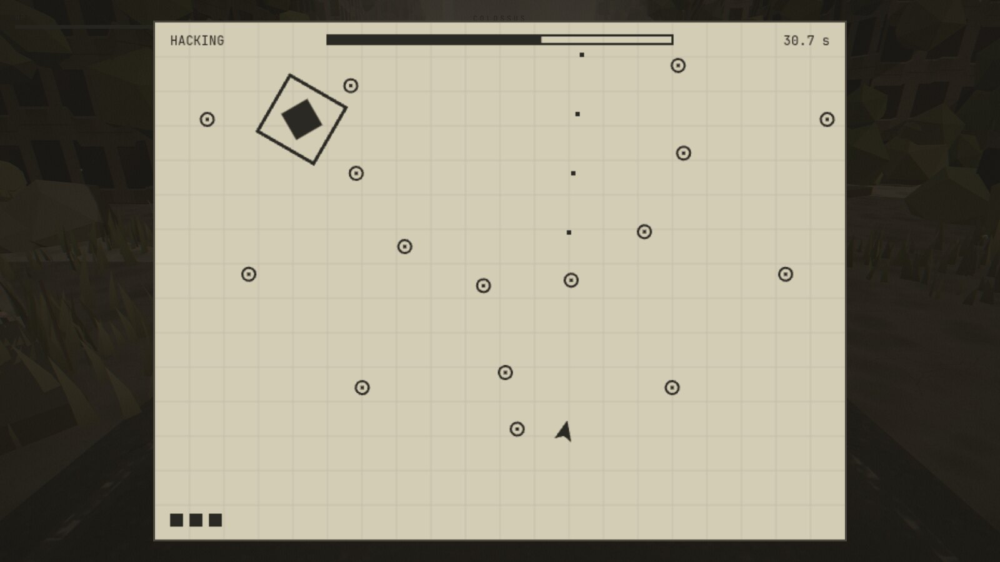
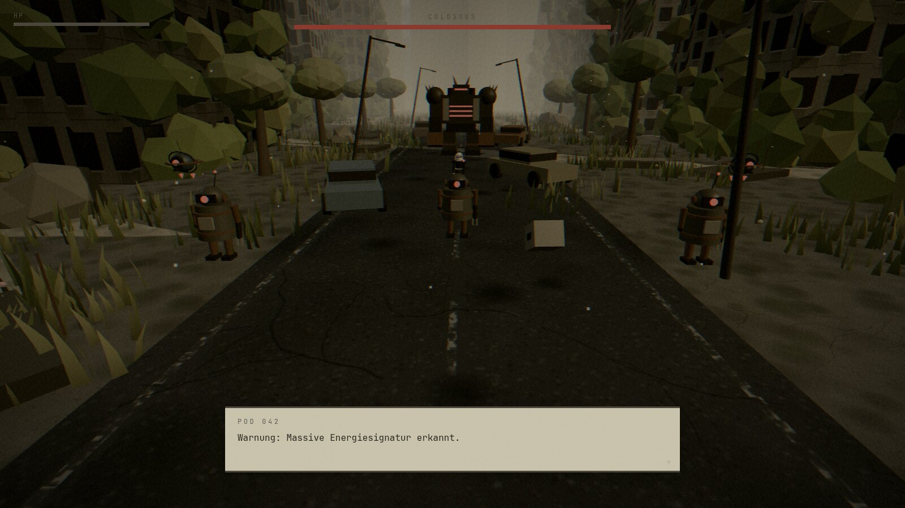
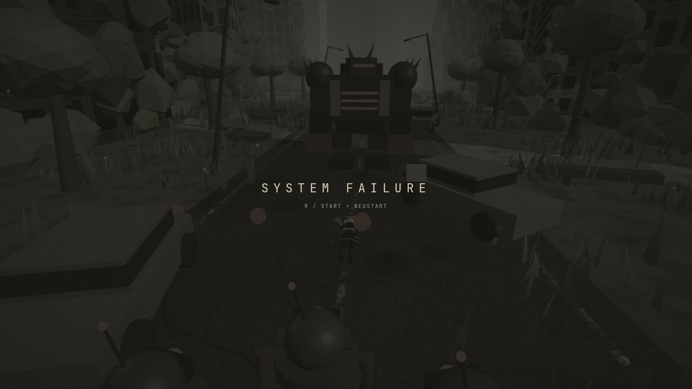

<div align="center">

# H O L L O W &nbsp; U N I T

**Die Menschheit ist fort. Die Maschinen sind geblieben. Du bist der Letzte, der noch kämpft.**

Ein stimmungsvolles 3D-Action-Spiel für den Browser, gebaut mit **three.js**.
Kein Download, keine Assets, keine Ladezeiten. Alles, was du siehst und hörst, wird beim Start im Code erzeugt.

[**Jetzt spielen →**](https://hollow-unit.vercel.app)



</div>

---

## Die Geschichte

Sektor 7 ist still. Hochhäuser brechen unter Efeu zusammen, ein Riesenrad dreht sich von selbst im Dunst, und Gras wächst durch den Asphalt. Nur die Maschinen laufen weiter, wie sie es immer taten.

Du bist **HOLLOW-01**, ein Android in schwarzem Kleid mit einem Schwert und einem schwebenden Begleiter, dem **POD 042**. Dein Auftrag: Die Straße hinunter bis ans Ende, vorbei an Läufern und Drohnen, und dann gegen das, was am Ende auf dich wartet.

> *„Warnung: Massive Energiesignatur erkannt."*



## Was dich erwartet

### Kampf mit Rhythmus
- **Dreifach-Kombo** mit dem Schwert: zwei schnelle Hiebe, ein wuchtiger Abschluss. Wer rechtzeitig nachdrückt, hält den Fluss.
- **Schwerer Angriff** mit großer Reichweite und Rückstoß, dafür langsam.
- **Ausweichen** macht dich kurz unverwundbar. Kugeln fliegen durch dich hindurch, und ein gut getimter Dash rettet dich vor jedem Schlag.
- **Doppelsprung**, um Schockwellen zu überspringen und auf Ruinen zu klettern.
- **Pod-Feuer**: dein Begleiter schießt dorthin, wohin die Kamera schaut.
- **Hitstop, Kamerawackeln, Funken und Glitch-Effekte** lassen jeden Treffer wuchtig wirken.



### Maschinen, die dich lesen
Jeder Gegner ist ein Zustandsautomat mit klarer Warnung vor dem Angriff: Er pulsiert rot, bevor er zuschlägt.

| Gegner | Verhalten |
|---|---|
| **Walker** (Schrottläufer) | Läuft heran, holt aus und springt vor. Ein Sprung über ihn hinweg weicht aus. |
| **Sentry** (Geschützdrohne) | Schwebt auf Abstand, umkreist dich und feuert Dreierserien. Ihre Kugeln sind langsam genug zum Ausweichen. |
| **Colossus** (Mini-Boss) | Stampft mit überspringbarer Schockwelle, stürmt mit voller Wucht und wird ab der halben Lebensenergie schneller und schießt dazu einen Kugelring. |



### Eine Welt, die lebt
- **Verfallene Stadt**: eine Straße mit abgenutzten Markierungen, 18 zerfallene Hochhäuser mit Fassaden, abgebrochene Dächer, rostige Autos, schiefe Laternen und Schutt.
- **Überwuchert**: Gras, das sich im Wind wiegt, Blumen, Efeu an den Wänden und verwilderte Bäume.
- **Himmel in Bewegung**: Wolken ziehen, die Sonne steht tief, und am Horizont verschwimmt eine Skyline im Nebel. Ganz hinten dreht sich ein stillgelegtes **Riesenrad**.
- **Atmosphäre**: Bloom, Filmkörnung, Vignette, ein warmer, entsättigter Look, dazu Staubkörner in der Luft.

### Ein Terminal, ein Minispiel
Neben dem Startpunkt steht ein Terminal. Hack es im **Top-Down-Shooter-Minispiel** gegen einen rotierenden Kern, und deine Systeme werden vollständig repariert. Du hast drei Leben und 45 Sekunden.



### Sprache und Klang
- **POD 042** spricht mit dir in einer Dialogbox mit Typewriter-Effekt und Tippgeräuschen.
- Die **Musik** ist eine ruhige Ambient-Melodie, die bei Gefechten dichter und schneller wird, und kommt komplett aus der Web-Audio-API. Dazu kommen Wind, Schritte, Schläge und Warntöne.



### Und wenn es schiefgeht
Bei niedrigen HP pulsiert ein roter Rand am Bildschirm. Fällt dein Kern aus, verblasst die Welt, und der Neustart bringt die Maschinen auf ihre Plätze zurück.



---

## Steuerung

| Aktion | Tastatur und Maus | Gamepad |
|---|---|---|
| Bewegen | `W` `A` `S` `D` / Pfeile | linker Stick |
| Kamera | Maus (erst ins Spiel klicken) | rechter Stick |
| Springen (2×) | `Leertaste` | `A` |
| Ausweichen | `Shift` | `B` / `RB` / `RT` |
| Leichter Angriff | Linke Maustaste / `J` | `X` |
| Schwerer Angriff | Rechte Maustaste / `K` | `Y` |
| Pod-Feuer (halten) | `E` | `LB` / `LT` |
| Terminal hacken | `F` | Steuerkreuz oben |
| Pause | `P` / `Esc` | `Start` |
| Neustart (nach dem Tod) | `R` | `Start` |
| Ton an/aus | `M` | – |

### Auf dem Handy

HOLLOW UNIT läuft auch im Mobilbrowser (Querformat). Beim Tippen auf „Start“ geht das Spiel, wo der Browser es erlaubt, in den Vollbildmodus.

| Aktion | Touch |
|---|---|
| Laufen | Daumen links aufsetzen und ziehen (der Stick erscheint dort, wo du tippst) |
| Kamera | rechts auf freier Fläche wischen |
| Angriff / Schwer / Springen / Ausweichen / Pod | Tasten rechts unten |
| Terminal hacken | Taste „HACKEN“ erscheint am Terminal |
| Pause | Taste „II“ oben rechts, außerdem pausiert das Spiel beim App-Wechsel |
| Dialog weiter / Neustart | irgendwo tippen |

Im Hochformat erscheint der Hinweis „Bitte Gerät drehen“. Auf dem iPhone ist Vollbild im Browser nicht möglich, die Seite lässt sich aber zum Home-Bildschirm hinzufügen.

Im Minispiel bewegst du dich mit `WASD` oder dem linken Stick, zielst mit der Maus oder dem rechten Stick und schießt mit Mausklick, `Leertaste` oder `A`/`RT`.

---

## Selbst starten

Du brauchst [Node.js](https://nodejs.org) (aktuelle LTS-Version).

```bash
git clone <dein-repository>
cd hollow-unit
npm install
npm run dev        # Entwicklungsserver mit Hot Reload
```

```bash
npm run build      # Typprüfung und Produktions-Build nach dist/
npm run preview    # den Build lokal ausprobieren
```

**Veröffentlichen:** `dist/` ist eine rein statische Seite.
- **Vercel:** `npx vercel deploy --prod` im Projektordner. Vite wird automatisch erkannt.
- **Itch.io:** Den Inhalt von `dist/` als ZIP hochladen und als „HTML-Spiel“ markieren. Die Pfade sind bereits relativ.

---

## Unter der Haube

HOLLOW UNIT kommt **ohne ein einziges Asset aus**. Es gibt keine Modelle, keine Bilder und keine Audiodateien:

- **Modelle** sind aus Primitiven zusammengesetzt und prozedural animiert (Beine, Arme, Rock und Haar der Spielfigur, Zahnräder und Rohre der Gegner).
- **Texturen** entstehen auf `<canvas>`: Beton mit Moos und Rissen, Asphalt mit Markierungen, Fassaden mit Fenstern und Verwitterung.
- **Himmel** ist ein eigener GLSL-Shader mit Wolken und Sonne. **Gras** ist eine einzige `InstancedMesh` mit Wind im Vertex-Shader.
- **Nachbearbeitung** (Bloom, Tonemapping, Körnung, Vignette, Glitch, Entsättigung) läuft über `EffectComposer` und einen eigenen Shader-Pass.
- **Audio** ist komplett synthetisch: Oszillatoren, gefiltertes Rauschen und ein Faltungshall.
- Die Welt ist **deterministisch**: Ein Seed-Zufallsgenerator sorgt dafür, dass sie bei jedem Start gleich aussieht.

| | |
|---|---|
| Engine | [three.js](https://threejs.org) |
| Build | [Vite](https://vitejs.dev) |
| Sprache | TypeScript |
| Hosting | Vercel (oder jeder statische Host) |

### Projektstruktur

```
src/
├── main.ts          Einstieg, Ladebalken
├── Game.ts          Zustände (Menü, Spiel, Pause, Dialog, Hacking), Hauptschleife
├── World.ts         Szene: Licht, Boden, Straße, Zusammenbau der Welt
│   ├── Sky.ts       Himmel-Shader
│   ├── Props.ts     Hochhäuser, Autos, Laternen, Schutt, Skyline, Riesenrad
│   ├── Foliage.ts   Gras, Blumen, Bäume
│   └── Textures.ts  Canvas-Texturen
├── Player.ts        Bewegung, Springen, Ausweichen, Leben
│   ├── Android.ts   Charaktermodell und prozedurale Animation
│   ├── Combat.ts    Schwertkombos und Trefferprüfung
│   └── Pod.ts       Begleiter und Projektile
├── Enemy.ts         Basisklasse mit Zustandsautomat, Gegner-Projektile
│   ├── EnemyTypes.ts   Walker, Shooter, Boss (Logik)
│   └── EnemyModels.ts  Modelle und Animationen der Gegner
├── Hacking.ts       Minispiel
├── Terminal.ts      Terminal in der Welt
├── Dialogue.ts      Dialogbox mit Typewriter
├── HUD.ts · Screens.ts   Oberfläche, Menü, Pause
├── PostFX.ts · Particles.ts · Fx.ts   Effekte
├── Audio.ts         Synthetische Musik und Soundeffekte
├── Input.ts         Tastatur, Maus (Pointer Lock), Gamepad
└── Colliders.ts · CameraRig.ts · rng.ts
```

### Für Entwickler
- Im Dev-Modus (`npm run dev`) verursacht `H` Schaden an dir, und `window.__game` gibt Zugriff auf das Spielobjekt. Beides fehlt im Produktions-Build.
- Werte zum Justieren stehen oben in den jeweiligen Dateien: Tempo, Sprung und Ausweichen in `Player.ts`, Gegnerwerte im Konstruktor in `EnemyTypes.ts`, Look in `PostFX.ts`.

---

## Mitmachen und Ideen

Ein paar Ideen für die Zukunft:
- Mehr Gegnertypen und weitere Bosse
- Eigene Charaktermodelle als GLB statt Primitive
- Mehrere Levelabschnitte und ein Speichersystem
- Eine Schwierigkeitswahl und Mobile-Steuerung
- Eine Bestenliste für das Hacking-Minispiel

Die Grafiken, Modelle, Texturen und Töne sind **alle im Code erzeugt**. Das Spiel ist von der Stimmung postapokalyptischer Android-Actionspiele inspiriert, enthält aber **keine** Figuren, Namen, Modelle oder Medien aus einem bestehenden Spiel. Es ist ein unabhängiges Fan-Projekt und steht in keiner Verbindung zu den Rechteinhabern solcher Spiele.

---

<div align="center">

*Möge dein Kern nicht erlöschen, Einheit.*

</div>
